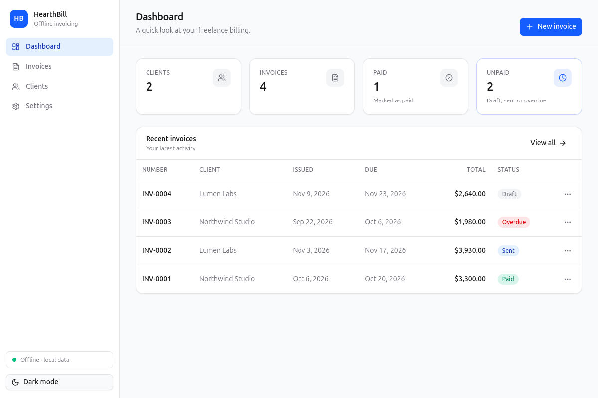
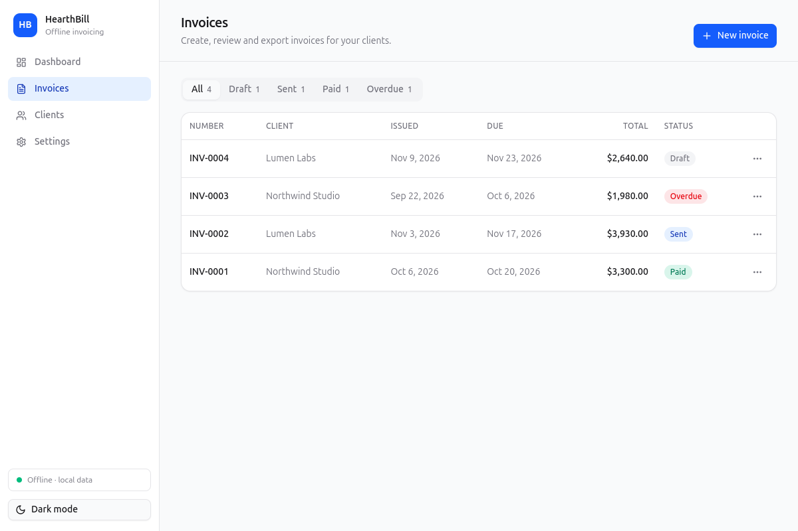
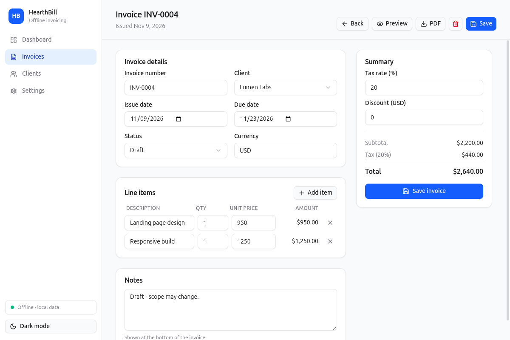
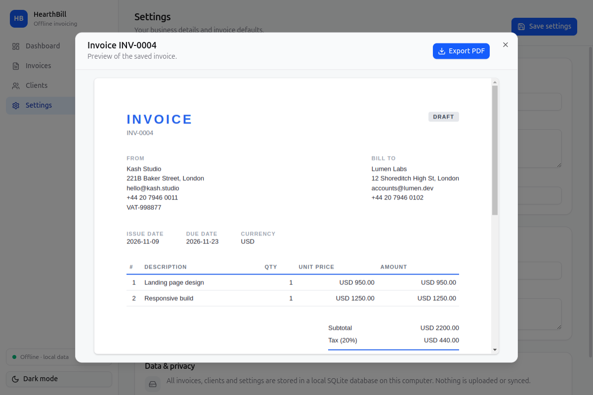
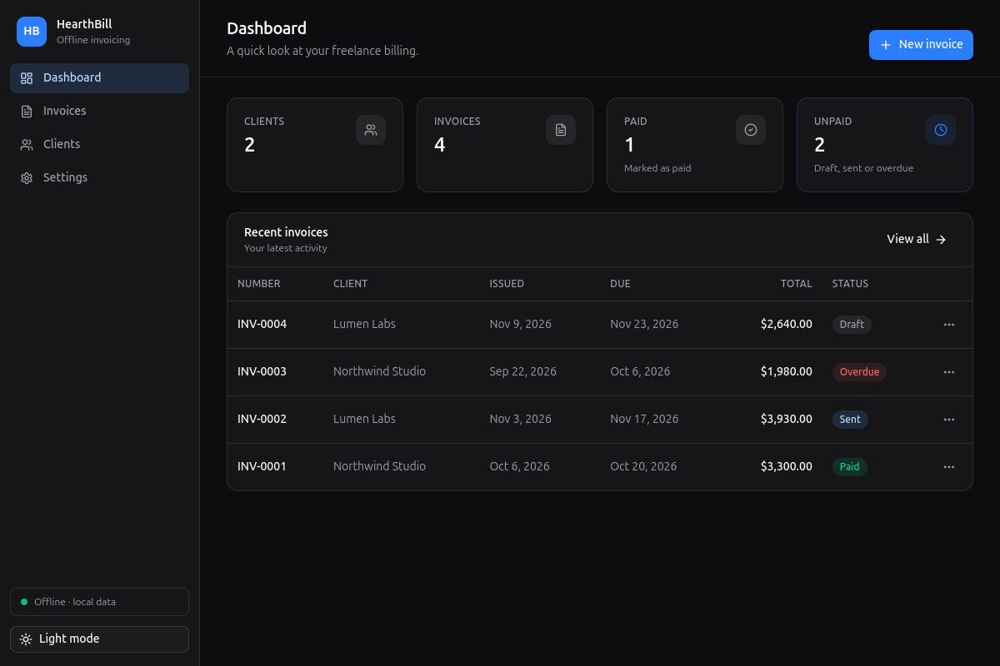

# HearthBill — Offline Invoice App for Freelancers

**Create professional PDF invoices on your desktop. No cloud, no account, no subscription.**


HearthBill is a free, local-first invoicing app built for freelancers, solo consultants, and independent contractors. It runs as a native desktop app on Linux, Windows, and macOS, stores every client and invoice in a local SQLite database, and exports clean A4 PDF invoices — completely offline.

If you have ever searched for a **freelancer invoice app without a subscription, without cloud sync, and without handing your client list to a third party**, this is it. Your data never leaves your computer.

> **The name:** *hearth* (the home fire) + *bill* (what you send). Invoicing that stays at home — local, private, and always available.

---

## Table of contents

- [Screenshots](#screenshots)
- [Why HearthBill](#why-hearthbill)
- [Features](#features)
- [HearthBill vs cloud invoice apps](#hearthbill-vs-cloud-invoice-apps)
- [Tech stack](#tech-stack)
- [Getting started](#getting-started)
- [How to create an invoice](#how-to-create-an-invoice)
- [Where your data lives](#where-your-data-lives)
- [Project structure](#project-structure)
- [Scripts](#scripts)
- [FAQ](#faq)
- [Roadmap](#roadmap)
- [Contributing](#contributing)
- [License](#license)
- [Search terms](#search-terms)

---

## Screenshots



*Dashboard — clients, invoice counts, and recent activity at a glance.*



*Invoices — filter by status, preview, edit, export PDF, or delete.*



*Invoice editor — client, dates, line items, tax, discount, and a live total.*



*Preview — check the finished invoice before exporting it as a PDF.*



*Dark mode — easy on late-night invoicing sessions.*

---

## Why HearthBill

- **100% offline.** No login, no sync, no telemetry. The app makes no network requests.
- **Local SQLite database.** Clients, invoices, line items, and settings live in a single local file you can back up yourself.
- **No subscription.** Free to use; no per-invoice limits and no account to maintain.
- **Privacy first.** Your client list and revenue history stay on your machine.
- **Made for freelancers.** One-person billing, not enterprise accounting. No chart of accounts, no payroll, no bloat.
- **Professional PDFs.** A clean A4 invoice template with your business details, client details, line items, tax, discount, and totals.
- **Works when the internet doesn't.** Flaky Wi-Fi, client sites, travel, or a deliberate offline setup — invoicing keeps working.

---

## Features

### Clients
- Add, edit, and delete clients
- Store name, email, phone, address, and tax/VAT ID
- Invoices keep a snapshot of client details even if the client is later deleted

### Invoices
- Auto-generated invoice numbers with a configurable prefix (`INV-0001`)
- Draft, sent, paid, and overdue statuses
- Issue and due dates
- Per-invoice currency
- Tax rate and discount
- Notes shown on the invoice
- Unlimited line items with quantity, unit price, and calculated amounts

### Export and sharing
- Live invoice preview inside the app
- One-click **PDF export** (A4, print-ready)
- `printToPDF` output that matches what you preview

### Business settings
- Business display name, email, phone, address, and tax ID
- Default currency and invoice number prefix
- Footer text for invoices
- Light and dark theme

### Data
- Local SQLite storage with no network sync
- Simple backup by copying the data folder
- Safe delete confirmations for clients and invoices

---

## HearthBill vs cloud invoice apps

| | **HearthBill** | Typical cloud invoice app |
|---|---|---|
| Works offline | ✅ Always | ❌ Needs internet |
| Account required | ✅ None | ❌ Email + password |
| Data storage | ✅ Local SQLite | ❌ Vendor cloud |
| Subscription | ✅ Free | ❌ Monthly fee |
| Per-invoice limits | ✅ None | Often capped |
| Client data leaves your device | ✅ Never | Usually yes |
| Sync across devices | ❌ By design | ✅ Usually yes |
| PDF invoice export | ✅ A4 | ✅ |

HearthBill is deliberately **not** a cloud product. If you need multi-device sync or team collaboration, a hosted tool is the better fit. If you want your invoicing to be private, local, and yours, HearthBill is built for that.

---

## Tech stack

| Layer | Technology |
|---|---|
| Desktop shell | Electron 33 |
| UI | React 18 + TypeScript |
| Build | Vite 6 |
| Styling | Tailwind CSS v4 + shadcn/ui-style components (Radix UI) |
| Icons / toasts | Lucide, Sonner |
| Database | SQLite via `better-sqlite3` |
| PDF | Electron `webContents.printToPDF` |
| Packaging | electron-builder |

---

## Getting started

### Requirements

- Node.js 20+
- Yarn 1.22+ or npm
- Linux, Windows, or macOS

### Run from source

```bash
git clone <your-repo-url> hearthbill
cd hearthbill

yarn install
yarn dev
```

`yarn dev` starts Vite and launches the Electron window with hot reload.

Using npm instead:

```bash
npm install
npm run dev
```

### Build and run the production app

```bash
yarn build
yarn start
```

### Package a distributable

```bash
yarn dist
```

Linux AppImage output is configured. Windows and macOS targets use electron-builder's defaults.

### Linux sandbox note

If Electron exits with a `SUID sandbox helper` error, either use the provided scripts (they set `ELECTRON_DISABLE_SANDBOX=1`) or fix the helper once:

```bash
sudo chown root:root node_modules/electron/dist/chrome-sandbox
sudo chmod 4755 node_modules/electron/dist/chrome-sandbox
```

---

## How to create an invoice

1. **Set up your business** in *Settings* — name, address, email, tax ID, default currency, and invoice prefix.
2. **Add a client** in *Clients* — name, email, phone, address, and tax/VAT ID.
3. **Create an invoice** — pick the client, set issue and due dates, and choose a status.
4. **Add line items** — description, quantity, and unit price. Set tax and discount if needed.
5. **Save, preview, and export** — review the PDF preview, then export the A4 PDF to send to your client.

Invoice numbers are generated automatically. You can override the number on any invoice if your bookkeeping requires a custom sequence.

---

## Where your data lives

HearthBill stores everything in Electron's per-user data directory:

```
<userData>/data/invoices.db
```

Typical locations:

| OS | Path |
|---|---|
| Linux | `~/.config/HearthBill/data/invoices.db` |
| macOS | `~/Library/Application Support/HearthBill/data/invoices.db` |
| Windows | `%APPDATA%\HearthBill\data\invoices.db` |

**Backup:** quit the app and copy the `data` folder. To restore, replace it while the app is closed.

**No sync:** there is no cloud account, no server, and no background upload. The database is yours.

---

## Project structure

```
.
├── electron/                 # Electron main process (CommonJS)
│   ├── main.js               # Window, IPC, PDF export, navigation guard
│   ├── db.js                 # SQLite schema and data layer
│   ├── invoiceTemplate.js    # Print-ready A4 invoice HTML
│   ├── preload.js            # contextBridge API
│   └── harness.js            # Dev-only smoke tests and screenshots
├── src/                      # React renderer
│   ├── components/
│   │   ├── ui/               # shadcn-style primitives
│   │   └── app/              # Sidebar, tables, dialogs, stat cards
│   ├── views/                # Dashboard, Invoices, Editor, Clients, Settings
│   ├── lib/                  # API wrapper, formatting, theme
│   ├── types.ts
│   └── index.css             # Tailwind v4 theme tokens (light + dark)
├── docs/screenshots/
├── index.html
├── vite.config.ts
├── tsconfig.json
└── package.json
```

---

## Scripts

| Command | What it does |
|---|---|
| `yarn dev` | Vite dev server + Electron with hot reload |
| `yarn build` | Build the renderer into `dist/renderer` |
| `yarn start` | Run the production build in Electron |
| `yarn typecheck` | TypeScript check with no emit |
| `yarn capture` | Dev harness: seed data and capture screenshots (light + dark) |
| `yarn dist` | Package the app with electron-builder |

---

## FAQ

### Is HearthBill really free?

Yes. There is no subscription, no per-invoice fee, and no account. The project is MIT licensed.

### Does it work without internet?

Yes. HearthBill is designed to work fully offline. It does not sync, upload, or call external services. You can use it on a machine with no network at all.

### Where are my invoices stored?

In a local SQLite database at `<userData>/data/invoices.db`. Nothing is stored in the cloud.

### Does HearthBill sync between devices?

No. Local-only is a deliberate design choice for privacy and simplicity. To move data, copy the `data` folder or back up the database file.

### Can I create a PDF invoice?

Yes. Every invoice can be previewed in the app and exported as a print-ready A4 PDF.

### Can I use different currencies?

Yes. Each invoice has its own currency code (for example `USD`, `EUR`, `GBP`), and you can set a default currency in Settings.

### Can I change the invoice number format?

Yes. Set the invoice prefix in Settings (for example `INV-` or `2026-`) and override the number on individual invoices if needed.

### What happens if I delete a client?

Invoices keep a snapshot of the client's details. The client is removed from the picker for new invoices, but existing invoices still show the original name and address.

### Is there a mobile version?

No. HearthBill is an Electron desktop app for Linux, Windows, and macOS.

### Is my data encrypted?

The database is a standard local SQLite file, protected by your operating system user account. Use full-disk encryption (FileVault, LUKS, BitLocker) if you need encryption at rest.

---

## Roadmap

- Recurring invoices
- Business logo upload on invoices
- CSV export of invoices and clients
- Additional invoice templates
- Multi-currency totals on the dashboard
- Keyboard shortcuts for faster entry

---

## Contributing

Issues and pull requests are welcome.

1. Fork the repository.
2. Create a branch: `git checkout -b feature/my-change`.
3. Make your changes and run `yarn typecheck && yarn build`.
4. Open a pull request with a clear description.

### GitHub topics to add

For discoverability, set these repository topics on GitHub:

```
invoice, invoicing, freelancer, freelance, offline, local-first, electron,
react, typescript, sqlite, pdf, privacy, billing, invoice-generator, desktop-app
```

---

## License

MIT. See `package.json` for the license declaration. HearthBill is provided as-is, without warranty; it is not a substitute for professional tax or accounting advice.

---

## Search terms

HearthBill is an **offline invoice app for freelancers**, a **freelancer invoice generator**, and a **privacy-first desktop invoicing app**. It is a good fit if you are looking for:

- offline invoice software with no subscription
- a local invoice database that stays on your computer
- a free invoice PDF maker for freelancers and solo consultants
- an Electron + React + SQLite invoicing app
- an invoice app without cloud sync or accounts
- desktop billing software for Linux, Windows, or macOS
